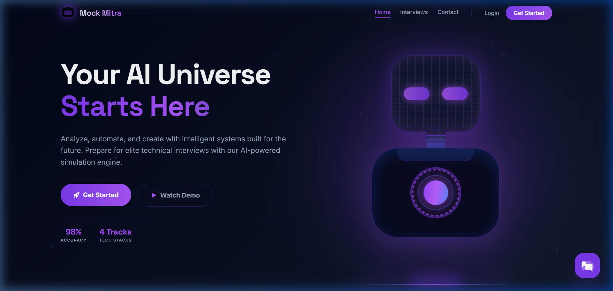
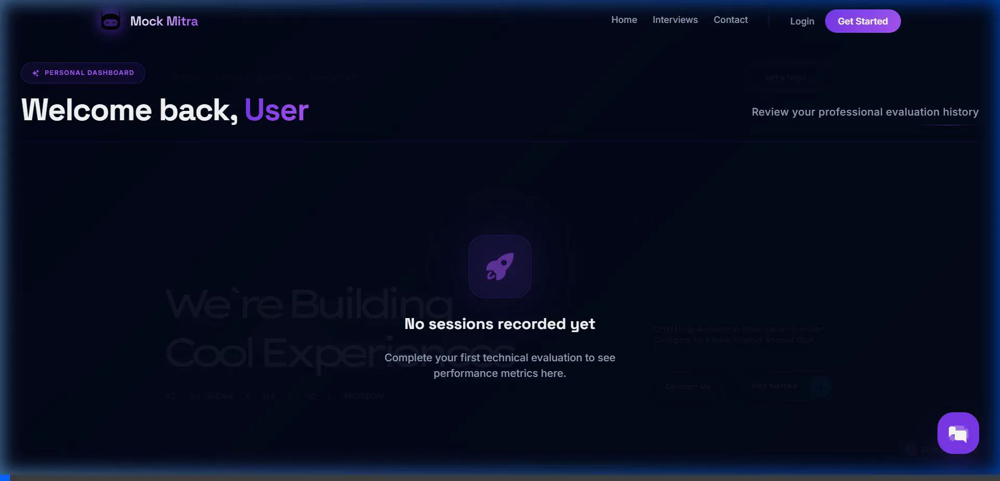
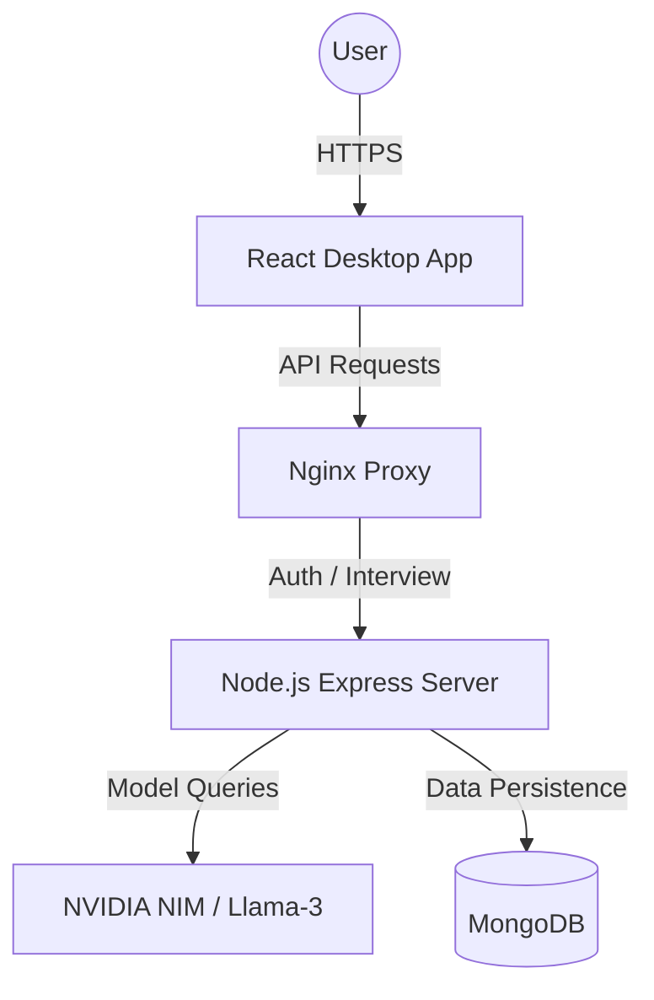

# 🤖 Mock Mitra
### Elevating Technical Interviews with AI-Driven Intelligence




**Mock Mitra** is a high-rigor, full-stack AI platform designed to bridge the gap between static coding practice and real-world technical interviews. By leveraging the power of **Llama-3.3 (70B Instruct)** via NVIDIA NIM, Mock Mitra provides candidates with a truly adaptive, high-fidelity interview experience that evaluates not just syntax, but architectural logic and professional communication.

---

## 🚀 The Problem & Our Mission
Technical interview preparation is broken. Candidates often spend hundreds of hours on static coding challenges that fail to prepare them for the **dynamic, conversational, and high-pressure** environment of a real technical round.

**Mock Mitra exists to:**
- Simulate the "Technical Strategist" persona that candidates face at top-tier tech firms.
- Provide objective, data-driven feedback on technical depth and communication skills.
- Remove bias from the initial screening process through AI-driven rigor.

---

## ✨ Key Features

- 🧠 **AI Technical Strategist**: Powered by Llama-3.3-70b, providing high-rigor, non-linear questioning.
- 🎯 **Domain-Specific Tracks**: Tailored sessions for MERN, Backend Engineering, Java Enterprise, and Data Analysis.
- 📊 **Macro Performance Reports**: Comprehensive final evaluations with technical scores, confidence metrics, and personalized improvement plans.
- 💬 **Intelligent Chat Assistant**: A persistent AI companion to guide users through the platform and answer career-related queries.
- 🎨 **Premium Aesthetics**: A stunning, futuristic UI built with Framer Motion and UnicornStudio 3D environments.
- 🔐 **Secure Authentication**: Robust JWT-based security and password hashing with Bcrypt.
- 🐳 **One-Click Deployment**: Fully containerized environment using Docker and Docker Compose.

---

## 📺 Demo Walkthrough



---

---

## 🏗️ Architecture & Workflow

Mock Mitra follows a modern, decoupled architecture designed for scale and low-latency AI responses.



### The Interview Flow
1. **Persona Initialization**: The AI adopts the role of a "Mock Mitra Technical Strategist".
2. **Contextual Questioning**: Questions are generated based on the chosen track and candidate's history to avoid repetition.
3. **Real-time Interaction**: Candidates provide answers which are buffered and prepared for final analysis.
4. **Macro Evaluation**: Upon completion, the AI performs a "Deep Scan" of the entire interview history to produce the final score.

---

## 💻 Tech Stack

### Frontend
| Tech | Icon | Purpose |
| :--- | :--- | :--- |
| **React** |  | Core UI components and state management. |
| **Tailwind CSS** |  | Post-modern, utility-first styling for speed and flexibility. |
| **Framer Motion** |  | High-end micro-interactions and route transitions. |
| **UnicornStudio** |  | Dynamic 3D fluid and cubic backgrounds. |

### Backend
| Tech | Icon | Purpose |
| :--- | :--- | :--- |
| **Node.js** |  | Scalable runtime for the interview engine. |
| **Express** |  | RESTful API architecture. |
| **MongoDB** |  | Flexible schema storage for users and interview transcripts. |
| **NVIDIA NIM** |  | Low-latency inference for Llama-3.3-70B model. |

---

## 📂 Folder Structure

```bash
├── frontend                # React + Tailwind SPA
│   ├── src
│   │   ├── Components      # Reusable UI elements (NavBar, Footer, etc.)
│   │   ├── Pages           # Core screens (Home, Dashboard, Interview)
│   │   ├── api             # Axios instance and config
│   │   └── assets          # Images and branding files
│   └── public              # Static assets and index.html
├── node-backend            # Express Server
│   ├── data                # Local question benchmarks
│   └── server.js           # Core logic, AI prompts, and DB setup
├── docker-compose.yml      # Multi-container orchestration
└── .env.example            # Environment template
```

---

## 🛠️ Installation & Setup

### Prerequisites
- **Node.js** (v18+)
- **Docker & Docker Compose**
- **NVIDIA NIM API Key** (or compatible OpenAI-standard endpoint)

### Local Configuration
1. **Clone the repository:**
   ```bash
   git clone https://github.com/your-username/MockMitra.git
   cd MockMitra
   ```

2. **Backend Setup:**
   Create `node-backend/.env` based on `.env.example`:
   ```env
   MONGO_URI=mongodb://127.0.0.1:27017/mock_mitra
   JWT_SECRET=your_secret_key
   NVIDIA_API_KEY=your_nvidia_api_key
   ```

3. **Frontend Setup:**
   Confirm API endpoints in `frontend/src/api/config.ts`.

---

## ⚡ Running Locally

### Option 1: Using Docker (Recommended)
Launch the entire stack with a single command:
```bash
docker-compose up --build
```
- Frontend: `http://localhost:3000`
- Backend: `http://localhost:8080`

### Option 2: Individual Components
**Start the Backend:**
```bash
cd node-backend
npm install
node server.js
```

**Start the Frontend:**
```bash
cd frontend
npm install
npm start
```

---

## 🛡️ Authentication & Security
- **Secure Hashing**: Passwords stored using `bcryptjs` with high salt rounds.
- **JWT Authorization**: Requests to interview endpoints are guarded by JSON Web Tokens.
- **Relative Path Proxying**: In production, Nginx proxies requests to prevent CORS exposure and mask backend ports.

---

## 📈 Roadmap
- [ ] **Voice Integration**: Real-time STT/TTS for verbal interviews.
- [ ] **Code Execution**: Integrated sandbox to run and test candidate code snippets.
- [ ] **Leaderboards**: Competitive ranking based on simulated industry scores.
- [ ] **Custom AI Personas**: Allow users to choose specific interviewer personalities (e.g., "The Architect", "The HR Specialist").

---

## 🤝 Contributing
We welcome contributions! Please see our [Contributing Guide](CONTRIBUTING.md) for more details. 
1. Fork the Project
2. Create your Feature Branch (`git checkout -b feature/NewFeature`)
3. Commit your Changes (`git commit -m 'Add some NewFeature'`)
4. Push to the Branch (`git push origin feature/NewFeature`)
5. Open a Pull Request

---

## 📄 License
Distributed under the **MIT License**. See `LICENSE` for more information.

---

## 👨‍💻 Contact & Author
**Mock Mitra Team**  
Email: [support@mockmitra.ai](mailto:support@mockmitra.ai)  
Project Link: [https://github.com/your-username/MockMitra](https://github.com/your-username/MockMitra)

---
<p align="center">
  Built with ❤️ for the technical community.
</p>
